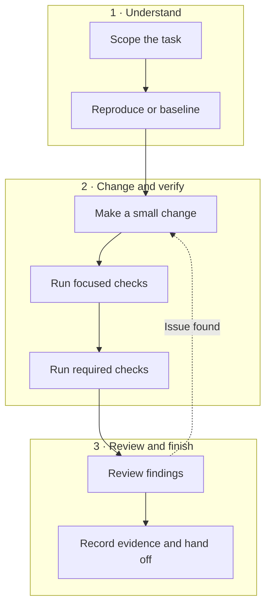
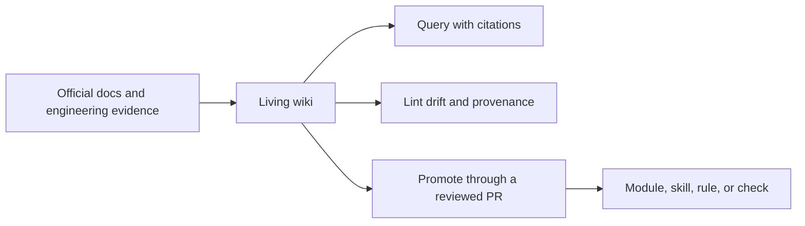
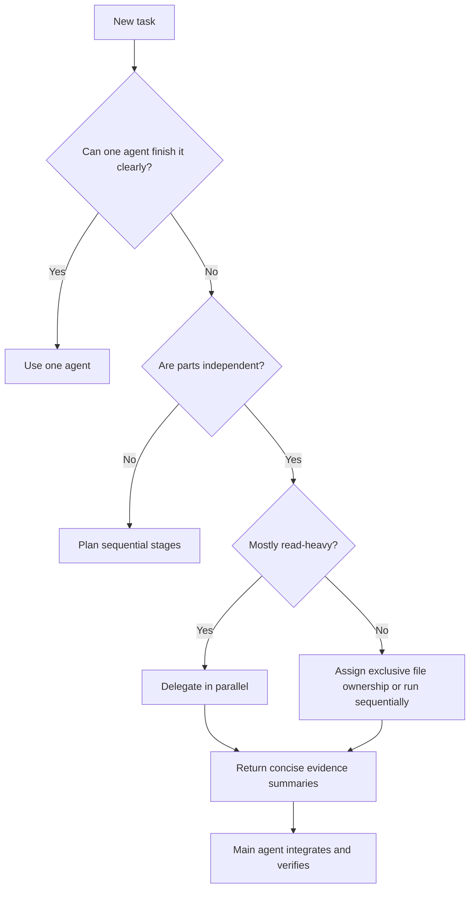

# Codex How To — русская редакция

Превратите работу с Codex в инженерный процесс, результат которого можно проверить.

Это руководство проводит задачу через уточнение границ, реализацию, тестирование,
ревью и сбор подтверждений. Отдельные рабочие процессы посвящены frontend,
backend, DevOps, безопасности и координации нескольких агентов.

[Английский оригинал](README.md) · [Описание русской редакции](EDITION.md)

## Что вы получите

- Последовательное знакомство с Codex: от модели работы и песочницы до сложных инженерных процессов.
- Специализированные навыки (Skills) для frontend, backend, DevOps, тестирования, безопасности, ревью и ограниченной оркестрации.
- Цикл работы над изменением: исходное состояние, реализация, тесты, проверка diff и передача результата с подтверждениями.
- Способы сокращать лишний контекст, число агентов, конфликты правок и повторные попытки.
- Подход к измерению того, улучшил ли навык или процесс с несколькими агентами результат задачи.

**Впервые работаете с Codex?** Начните с
[пятиминутного практикума без зависимостей](translations/ru/labs/engineering-playground/README.md).
**Уже используете Codex?** [Установите `engineering-loop`](#попробуйте-engineering-loop).
**Хотите быстро улучшить работу?** Изучите
[10 практических советов](translations/ru/resources/codex-tips.md): готовые запросы и условия, в которых они полезны.


[](https://github.com/Phelan164/codex-howto/actions/workflows/validate.yml)
[](https://github.com/Phelan164/codex-howto/releases/latest)
[](LICENSE)
[](https://skills.sh/phelan164/codex-howto)
[](https://skillstore.io/skills/phelan164-engineering-loop)
[](https://skillstore.io/skills/phelan164-engineering-loop)

[Начать обучение](translations/ru/modules/00-mental-model/README.md) ·
[Попробовать инженерный цикл](#попробуйте-engineering-loop) ·
[Посмотреть результаты измерений](#что-показали-первые-измерения) ·
[Открыть каталог навыков](#каталог-инженерных-навыков) ·
[Создать проверенную редакцию](translations/ru/resources/fork-an-edition.md) ·
[Внести вклад](#как-внести-вклад)

> **Статус оригинала:** проект активно развивается. Последний указанный выпуск:
> [v0.6.0](https://github.com/Phelan164/codex-howto/releases/tag/v0.6.0).
> Содержимое оригинала сверено с официальной документацией Codex 2026-07-31.
> Codex быстро меняется: проверяйте настройки и команды по ссылкам на
> **официальные источники**. Дата перевода не означает повторной проверки поведения продукта.

## Выберите минимально достаточный процесс

Не устанавливайте все навыки по умолчанию. Начните с минимального набора
инструкций, который способен повлиять на результат вашей задачи.

| Задача | С чего начать | Когда это полезно |
|---|---|---|
| Освоить основы Codex | [Модель работы](translations/ru/modules/00-mental-model/README.md) | Нужны последовательный курс, понимание песочницы, запросов, инструментов и проверки результатов |
| Исправить один локализованный дефект | [Тестирование и ревью](translations/ru/modules/07-testing-and-review/README.md) | Границы задачи и критерий приёмки уже ясны; навык полного цикла может добавить больше контекста, чем пользы |
| Реализовать возможность, затрагивающую несколько компонентов | [`engineering-loop`](skills/engineering-loop/SKILL.md) | Реализацию, тестирование, ревью и передачу подтверждений нужно связать в единый проверяемый цикл |
| Безопасно разделить большую задачу | [Матрица решений об оркестрации](translations/ru/resources/orchestration-decision-matrix.md) | Есть независимые области ответственности и интеграционные проверки |
| Сохранить знания команды | [Codex Living Wiki](translations/ru/knowledge/README.md) | Повторяющиеся исследования и решения должны стать проверенными знаниями репозитория со ссылками на источники |

Не уверены? Пройдите [пятиминутный практикум](translations/ru/labs/engineering-playground/README.md)
до глобальной установки чего-либо.

### Примените, проверьте, улучшите

1. **Примените:** [установите основной навык](#попробуйте-engineering-loop) или пройдите
   [практикум без зависимостей](translations/ru/labs/engineering-playground/README.md).
2. **Проверьте:** изучите [исходные записи запусков](examples/measurements/engineering-loop-runs.csv),
   прежде чем доверять заявлению об эффективности.
3. **Улучшите:** [создайте форк](https://github.com/Phelan164/codex-howto/fork),
   запустите тот же оценщик на своём стеке и поделитесь результатом без конфиденциальных данных.

Если процесс помог избежать неудачной итерации, [добавьте репозиторий в избранное](https://github.com/Phelan164/codex-howto),
чтобы следить за новыми измерениями. Форк полезнее всего, когда в нём появляются
воспроизводимая задача, оценщик, исправление, перевод или профиль рабочего процесса.

## Попробуйте engineering-loop

Установите основной навык через
[установщик сообщества skills.sh](https://skills.sh/phelan164/codex-howto):

```bash
npx skills add Phelan164/codex-howto --skill engineering-loop -g -a codex -y
```

Начните новую задачу Codex в небольшом проекте под управлением системы контроля версий:

```text
$engineering-loop Реализуй это изменение полностью. Продолжай до выполнения
целевых тестов, обязательных проверок, ревью diff и исправления подтверждённых
дефектов. Сообщи, какие команды выполнены, какие подтверждения получены и что
осталось непроверенным.
```

Ожидайте фиксации исходного состояния, ограниченной реализации, целевых и
обязательных проверок, финального ревью diff и передачи результата с подтверждениями.
До установки изучите [исходный текст навыка](skills/engineering-loop/SKILL.md)
или сначала пройдите [пятиминутный практикум](translations/ru/labs/engineering-playground/README.md).

## Как устроен инженерный цикл



Читайте схему сверху вниз: понять задачу, воспроизвести проблему или зафиксировать
исходное состояние, внести и проверить небольшое изменение, затем провести ревью
и передать подтверждения. Если ревью выявило подтверждённый дефект, вернитесь к изменению.
Код схемы сохранён из оригинала.

Сгенерированный код здесь считается промежуточным результатом. Для завершения
нужны наблюдаемое поведение, подходящие проверки, ревью diff и явное описание того,
что осталось непроверенным.

| Работа с Codex без устойчивого процесса | Процесс из этого руководства |
|---|---|
| Начать с расплывчатой просьбы | Задать цель, контекст, ограничения и критерии завершения |
| Сгенерировать большое решение за один проход | Воспроизвести проблему, внести минимальную правку и проверять поэтапно |
| Загрузить широкий контекст «на всякий случай» | Выбрать один навык полного цикла и только нужных специалистов |
| Считать успешный вывод доказательством | Записать команды, результаты, замечания ревью и остаточные риски |
| Добавлять агентов, потому что доступен параллелизм | Делегировать только независимую работу с чёткими границами |

## Что показали первые измерения

Навыки не гарантируют повышения эффективности. В контролируемых запусках
GPT-5.6-sol лучший вариант зависел от размера задачи.

| Задача | Результат по качеству | Вариант с наименьшим расходом токенов |
|---|---|---|
| Небольшое исправление проверки граничных значений в backend | Все три варианта прошли проверки | Без навыка репозитория: 390,144 токена по отчёту |
| Браузерная игра 2048 среднего объёма | Все три варианта прошли проверки | Компактный навык v0.4.0: 380,767 токенов по отчёту |

В задаче с игрой компактный `engineering-loop` использовал **на 31.2% меньше
токенов по отчёту, чем v0.2.0**, и **на 54.0% меньше, чем контрольный вариант
без навыка репозитория**. В небольшой задаче backend контрольный вариант
оставался самым экономным. Это позволяет предположить, что инструкции полного
цикла могут быть избыточными для локальной правки, но полезными для задачи,
включающей реализацию, тестирование, ревью и передачу подтверждений.

Это две начальные контролируемые задачи, а не универсальные утверждения
о производительности. Прежде чем менять процесс команды, прочитайте
[результат backend](examples/measurements/gpt-5.6-sol-backend-boundary-2026-07-31.md),
[результат 2048](examples/measurements/gpt-5.6-sol-2048-game-2026-07-31.md)
и [протокол измерений](translations/ru/resources/engineering-loop-measurement.md).

[Интерактивный просмотр результатов](https://codex-howto-benchmark.nguyenvantamdk2.chatgpt.site)
показывает шесть запусков: переключение между размерами задачи, пропорциональное
сравнение токенов, таблицу запусков, методику и ограничения. Исходный код и
отрендеренные данные проверяются в CI, сохраняя связь с измерениями репозитория.
[Отдельная статья](translations/ru/resources/articles/do-codex-skills-save-tokens.md) объясняет
постановку, результаты, гипотезу о границах применимости и протокол воспроизведения.
[Вьетнамская редакция](resources/articles/do-codex-skills-save-tokens.vi.md)
сохраняет те же измерения и ограничения для локальной публикации.

## Измеряйте процессы вместо накопления навыков

В известных проектах сообщества уже есть сильные инженерные подходы.
[`mattpocock/skills`](https://github.com/mattpocock/skills) делает упор на
небольшие, сочетаемые процессы для реальной разработки.
[`obra/superpowers`](https://github.com/obra/superpowers) предлагает более
строго заданный цикл проектирования, планирования, TDD, ревью и проверки.

Этот репозиторий не включает и не переименовывает их каталоги. Он предоставляет
[профили сравнения](translations/ru/resources/third-party-workflow-profiles.md) и общий
[отчёт об измерении задачи](translations/ru/examples/templates/measured-task-receipt.md).
Так команды могут сравнивать работу без навыка, компактный цикл Codex и выбранные
сторонние процессы при одинаковых условиях задачи.

Полезный вопрос: какой минимальный процесс настолько улучшает приёмку,
подтверждения или безопасность, что оправдывает затраты на контекст, контрольные
точки, время и суммарное число токенов для этого класса задач?

## Пятиминутная инженерная демонстрация

Используйте [практикум без зависимостей](translations/ru/labs/engineering-playground/README.md)
для безопасной демонстрации полного цикла исправления backend-дефекта:

```bash
demo_root="$(mktemp -d)"
cp -R labs/engineering-playground "$demo_root/playground"
mkdir -p "$demo_root/playground/.agents/skills"
cp -R skills/engineering-loop "$demo_root/playground/.agents/skills/"
cd "$demo_root/playground"
git init
```

Запустите Codex в этой директории и отправьте запрос:

```text
$engineering-loop Изучи контракт резервирования запасов, воспроизведи один
непокрытый дефект обработки входных граничных значений, добавь минимальный
регрессионный тест, исправь дефект, выполни обязательные проверки и проведи
ревью итогового diff. Работай только в этой временной копии практикума.
```

Ищите четыре подтверждения: падающий до исправления регрессионный тест,
небольшой diff реализации, успешные целевые проверки и итоговый отчёт.
Затем используйте [протокол измерений](translations/ru/resources/engineering-loop-measurement.md),
чтобы сравнить запуски без навыка, с полной и компактной версиями навыка.
Одна демонстрация сама по себе не доказывает эффективность.

Для более объёмной реализации используйте [benchmark 2048 без зависимостей](translations/ru/labs/2048-game-benchmark/README.md)
и изучите [первое измерение GPT-5.6-sol](examples/measurements/gpt-5.6-sol-2048-game-2026-07-31.md).
Для измерения большой задачи, которую можно действительно разделить,
сравните одного агента с агентами, имеющими отдельные области ответственности
в backend и frontend, в [benchmark реагирования на инциденты](translations/ru/labs/incident-response-benchmark/README.md).
[Статья о выборе нескольких агентов](translations/ru/resources/articles/when-should-codex-use-multiple-agents.md)
объясняет правило ответственности, пробные измерения, контракт управляющего агента,
недопустимые выводы и протокол воспроизведения.
[translations/ru/PRESENTING.md](translations/ru/PRESENTING.md) содержит план 15-минутного выступления,
чек-лист демонстрации и готовый анонс.

## Накапливайте знания о работе с Codex

[Codex Living Wiki](translations/ru/knowledge/README.md) превращает повторные исследования
в проверенный слой знаний со ссылками на источники:



Схема показывает переход от официальных документов и инженерных подтверждений
к живой wiki: ответы со ссылками, проверка актуальности и происхождения,
затем перенос проверенных знаний через PR в модуль, навык, правило или проверку.

Подход адаптирует [идею LLM Wiki Карпати](https://gist.github.com/karpathy/442a6bf555914893e9891c11519de94f)
к инженерной работе с Codex. Полные тексты внешних источников по умолчанию
не попадают в Git, детерминированный линтер проверяет формальную целостность,
а фактические изменения проходят ревью человеком.

Попробуйте запрос только на чтение:

```text
$maintain-codex-wiki Что этот репозиторий знает об эффективности оркестрации?
Ссылайся на страницы wiki, отделяй подтверждения от рекомендаций и не изменяй файлы.
```

Wiki начинается с Markdown и поиска по репозиторию. База данных, embeddings
и MCP-сервис нужны только тогда, когда измеренное качество поиска их оправдывает.

## Зачем существует этот репозиторий

Официальная документация — основной источник сведений о поведении продукта.
Репозиторий превращает эти возможности в практический курс для инженеров.

Вы научитесь:

- давать Codex достаточный контекст, не перегружая диалог;
- закреплять правила репозитория в `AGENTS.md`;
- оформлять повторяющиеся frontend-, backend-, DevOps-задачи, тестирование, ревью и проверки безопасности в навыки;
- подключать внешние системы через MCP;
- выбирать безопасные настройки песочницы и согласования действий;
- делегировать работу с чёткими границами специализированным агентам;
- координировать параллельную работу без конфликтов правок;
- сокращать лишний контекст, повторные попытки и расход токенов;
- собирать развивающиеся знания о Codex в живую wiki с обязательным ревью;
- автоматизировать устойчивые процессы после того, как они надёжно работают интерактивно.

## Что входит в руководство

- **14 последовательных модулей:** безопасность, запросы, `AGENTS.md`, навыки,
  MCP, субагенты, оркестрация, эффективность контекста, автоматизация и поддержка знаний.
- **9 устанавливаемых навыков:** полный инженерный цикл, frontend, backend,
  DevOps, тестирование, ревью кода, безопасность, оркестрация и поддержка знаний
  с предварительным ревью. Отдельный маршрутизатор оставлен учебным примером.
- **Живая wiki сопровождающих:** зарегистрированные источники, детерминированные
  проверки, этапы ревью и измеримый путь переноса знаний в курс.
- **Готовые примеры:** конфигурация проекта, пользовательские агенты, запросы,
  спецификации, задачи с зависимостями, передача результата, hooks, MCP и локальные плагины.
- **Практикум без зависимостей** с намеренно внесёнными дефектами для безопасной
  отработки полного цикла «реализация — тестирование — ревью».

## Для кого предназначен курс

- **Начинающие:** могут открыть Codex, но ещё не знают, как сформулировать реальную задачу.
- **Практикующие инженеры:** хотят воспроизводимые процессы для рабочих репозиториев.
- **Технические руководители:** нуждаются в общих инструкциях для агентов и стандартах ревью.
- **Платформенные команды:** создают навыки, плагины, MCP-интеграции и автоматизацию CI.

## Выберите маршрут

| Цель | С чего начать |
|---|---|
| Освоить безопасные основы Codex | [Маршрут A · Безопасный старт](translations/ru/LEARNING-ROADMAP.md#маршрут-a-безопасный-старт) |
| Разрабатывать и проверять код приложений | [Маршрут B · Разработчик приложений](translations/ru/LEARNING-ROADMAP.md#маршрут-b-разработчик-приложений) |
| Работать с доставкой и инфраструктурой | [Маршрут C · Платформа и DevOps](translations/ru/LEARNING-ROADMAP.md#маршрут-c-платформа-и-devops) |
| Эффективно координировать субагентов | [Маршрут D · Оркестрация агентов](translations/ru/LEARNING-ROADMAP.md#маршрут-d-оркестрация-агентов) |
| Поддерживать развивающиеся знания о Codex | [Маршрут E · Сопровождение знаний](translations/ru/LEARNING-ROADMAP.md#маршрут-e-сопровождение-знаний) |
| Учиться, исправляя небольшой проект | [Инженерный практикум](translations/ru/labs/engineering-playground/README.md) |

## Последовательность обучения

| Этап | Модуль | Результат | Время |
|---|---|---|---:|
| Основы | [00 · Модель работы](translations/ru/modules/00-mental-model/README.md) | Выбрать подходящий интерфейс Codex и форму задачи | 25 мин |
| Основы | [01 · Песочница и согласования](translations/ru/modules/01-sandbox-and-approvals/README.md) | Задать безопасные границы автономности до первой записи | 45 мин |
| Основы | [02 · CLI и интерфейсы](translations/ru/modules/02-cli-and-surfaces/README.md) | Установить Codex, войти, ориентироваться и безопасно исследовать проект | 35 мин |
| Основы | [03 · Запросы и планы](translations/ru/modules/03-prompts-and-plans/README.md) | Формулировать задачи с ясными границами и проверяемым завершением | 40 мин |
| Основы | [04 · AGENTS.md](translations/ru/modules/04-agents-md/README.md) | Закрепить локальные инструкции репозитория | 45 мин |
| Разработка | [05 · Инженерные навыки](translations/ru/modules/05-engineering-skills/README.md) | Создавать и устанавливать повторно используемые процессы | 60 мин |
| Разработка | [06 · MCP и инструменты](translations/ru/modules/06-mcp-and-tools/README.md) | Подключать актуальные данные и действия без перегрузки инструкций | 45 мин |
| Разработка | [07 · Тестирование и ревью](translations/ru/modules/07-testing-and-review/README.md) | Замкнуть цикл реализации, проверки и ревью | 55 мин |
| Масштабирование | [08 · Субагенты](translations/ru/modules/08-subagents/README.md) | Делегировать узкие независимые задачи | 50 мин |
| Масштабирование | [09 · Оркестрация](translations/ru/modules/09-orchestration/README.md) | Координировать агентов с ясной ответственностью | 70 мин |
| Масштабирование | [10 · Контекст и токены](translations/ru/modules/10-context-and-token-efficiency/README.md) | Сокращать загрязнение контекста и дорогие повторные попытки | 50 мин |
| Масштабирование | [11 · Автоматизация, плагины и hooks](translations/ru/modules/11-automation-plugins-hooks/README.md) | Упаковывать и автоматизировать устойчивые процессы | 60 мин |
| Эксплуатация | [12 · Диагностика проблем](translations/ru/modules/12-troubleshooting/README.md) | Определять причины сбоев по слоям | 35 мин |
| Эксплуатация | [13 · Живая wiki Codex](translations/ru/modules/13-living-codex-wiki/README.md) | Собирать, проверять и переносить развивающиеся знания | 55 мин |

Полный курс занимает около **10–11 часов**. Начните с модулей 00–03,
затем выберите самый короткий маршрут, подходящий для вашей работы.

## Безопасный старт за пять минут

1. Установите Codex по [официальной инструкции](https://developers.openai.com/codex/quickstart).
2. Откройте небольшой репозиторий под управлением системы контроля версий.
3. Отправьте запрос:

   ```text
   Цель: объяснить, как этот репозиторий собирается и тестируется.
   Контекст: изучи конфигурацию в корне и документацию для участников.
   Ограничения: только чтение; не устанавливай зависимости и не изменяй файлы.
   Завершено, когда: перечислены точные команды сборки, тестирования, линтинга
   и проверки типов со ссылками на файлы, в которых они определены.
   ```

4. Проверьте результат.
5. Создайте начальный `AGENTS.md` через `/init`, затем замените общие формулировки проверенными командами.

## Каталог инженерных навыков

Начните с модели, условий задачи и инструкций репозитория. Добавляйте один
специализированный навык, только если он улучшает измеримый инженерный результат
или даёт конкретные знания о процессе, безопасности, правилах или инструментах.
До стандартизации навыка в команде изучите [руководство по навыкам с учётом модели](translations/ru/resources/model-adaptive-skills.md)
и [протокол сравнения трёх вариантов](translations/ru/resources/engineering-loop-measurement.md).

В репозитории девять устанавливаемых начальных навыков:

| Навык | Назначение |
|---|---|
| [`engineering-loop`](skills/engineering-loop/SKILL.md) | Провести изменение через исходное состояние, реализацию, тесты, ревью и подтверждения |
| [`build-frontend`](skills/build-frontend/SKILL.md) | Реализовать доступный UI с визуальной и поведенческой проверкой |
| [`build-backend`](skills/build-backend/SKILL.md) | Безопасно изменять API, сервисы, хранение данных и контракты |
| [`operate-devops`](skills/operate-devops/SKILL.md) | Изменять доставку и инфраструктуру с проверкой возможности отката |
| [`review-code`](skills/review-code/SKILL.md) | Находить существенные дефекты, регрессии и пробелы в тестах |
| [`test-software`](skills/test-software/SKILL.md) | Проектировать тесты с учётом риска и реализовывать наиболее ценное покрытие |
| [`review-security`](skills/review-security/SKILL.md) | Прослеживать границы доверия и сообщать об эксплуатируемых рисках |
| [`orchestrate-engineering`](skills/orchestrate-engineering/SKILL.md) | Координировать агентов, защищать контекст и избегать конфликтов правок |
| [`maintain-codex-wiki`](skills/maintain-codex-wiki/SKILL.md) | Запрашивать, фиксировать, включать, архивировать, проверять и переносить знания с предварительным ревью |

[Быстрый старт](#попробуйте-engineering-loop) устанавливает `engineering-loop`.
Установите навык сопровождения Living Wiki через ту же
[экосистему навыков агентов](https://skills.sh/phelan164/codex-howto):

```bash
npx skills add Phelan164/codex-howto --skill maintain-codex-wiki -g -a codex -y
```

У основных навыков есть страницы с независимым сканированием в SkillStore:
[Engineering Loop](https://skillstore.io/skills/phelan164-engineering-loop)
и [Maintain Codex Wiki](https://skillstore.io/skills/phelan164-maintain-codex-wiki).

Посмотреть все девять навыков без установки:

```bash
npx skills add Phelan164/codex-howto --list
```

Другой вариант — изучить навык и скопировать его в `.agents/skills/` для проекта
или `~/.agents/skills/` для личного повторного использования:

```bash
mkdir -p .agents/skills
cp -R /path/to/codex-howto/skills/review-code .agents/skills/
```

Изучите каждый навык перед установкой, начните новую задачу и вызовите его явно:

```text
$review-code Проведи ревью этой ветки относительно main. Начни с существенных
замечаний и перечисли проверки, которые не удалось выполнить.
```

Маршрутизатор [`choose-engineering-flow`](examples/skills/choose-engineering-flow/SKILL.md),
вызываемый только явно, оставлен учебным примером и не рекомендуется как
обязательная зависимость рабочего процесса. Обычно ясные описания навыков
позволяют Codex выбрать процесс без дополнительного шага маршрутизации.
Оркестратор требует явного вызова: случайное включение добавляет затраты на координацию.
`maintain-codex-wiki` тоже вызывается явно, поскольку фиксация, включение,
архивирование и перенос знаний могут изменить общие фактические инструкции.

Для полного локального цикла разработки, тестирования и ревью установите
`engineering-loop` и начните с запроса:

```text
$engineering-loop Реализуй это изменение полностью. Продолжай до выполнения
целевых тестов, обязательных проверок, ревью diff и исправления подтверждённых
дефектов. Остановись, если не хватает полномочий или тестовая среда неоднозначна.
```

## Правило оркестрации

По умолчанию используйте одного агента. Добавляйте агентов, только если работа
состоит из независимых частей с чёткими границами.



Логика схемы: если один агент справится, оставьте одного. Зависимые части
выполняйте последовательно; независимое исследование можно распараллелить.
При записи закрепите файлы за единственными владельцами. Агенты возвращают
краткие подтверждения, главный агент объединяет и проверяет результат.

Параллельные агенты часто сокращают время и защищают основной диалог от шумных
логов, но обычно расходуют **больше токенов суммарно**. Цель эффективности —
меньше неудачных циклов и чище контекст.

Нужны настраиваемые модели для делегируемой работы? Изучите экспериментальные
[hooks маршрутизации моделей субагентов](translations/ru/examples/hooks/model-routing/README.md):
личные уровни easy/medium/difficult, сохранение явного выбора, минимальные
требования к ревьюеру и ограниченная эскалация. Нужны настройка и проверка
во время работы; это не меняет модель основного приложения и не доказывает экономии токенов.

Для необязательной **маршрутизации основных ходов в CLI** см.
[экспериментальный пилот JEV Router](translations/ru/resources/jev-router-pilot.md).
Он описывает передачу запросов третьей стороне, проверки совместимости и
сравнение времени и расхода с приоритетом качества. Для курса установка не нужна;
экономия в этом пилоте пока не установлена.

## Карта репозитория

```text
codex-howto/
├── .github/                 # Validation workflow and PR template
├── .codex-plugin/           # Plugin manifest over the existing skill catalog
├── modules/                 # Progressive tutorials and labs
├── skills/                  # Installable engineering skills
├── knowledge/               # Review-first maintainer evidence wiki
├── labs/
│   └── engineering-playground/ # Self-contained practice project
├── examples/
│   ├── agents/              # Project-scoped custom agent definitions
│   ├── config/              # Conservative Codex configuration
│   ├── prompts/             # Copy-ready task and orchestration prompts
│   └── AGENTS.md            # Starter repository guidance
├── resources/               # Checklists and comparison material
└── scripts/validate_repo.py # Offline structural validation
```

В `modules/` — последовательные уроки; в `skills/` — устанавливаемые навыки;
в `knowledge/` — wiki подтверждений; в `labs/` — практикумы; в `examples/` —
агенты, конфигурации и запросы; в `resources/` — справочные материалы.
Русские учебные тексты зеркально расположены в `translations/ru/`.

Полный индекс — [translations/ru/CATALOG.md](translations/ru/CATALOG.md), рекомендуемые маршруты —
[translations/ru/LEARNING-ROADMAP.md](translations/ru/LEARNING-ROADMAP.md).

Для полного упражнения без зависимостей скопируйте
[инженерный практикум](translations/ru/labs/engineering-playground/README.md) во временную
директорию и отработайте backend, frontend, DevOps, тестирование, ревью,
безопасность и оркестрацию на намеренно внесённых дефектах.

## Правила работы с источниками

- Утверждения о поведении и конфигурации продукта должны ссылаться на официальную документацию OpenAI.
- Примеры сообщества должны быть обозначены как материалы сообщества.
- Примеры, зависящие от версии, должны содержать дату проверки.
- Секреты, учётные данные production и опасные настройки по умолчанию не включаются.
- Маркетинговые заявления вроде «производительность в 10 раз выше» намеренно исключены.

## Источники вдохновения и связанные проекты

Идея последовательных модулей вдохновлена [luongnv89/claude-howto](https://github.com/luongnv89/claude-howto).
Это самостоятельный курс о Codex; тексты уроков и шаблоны того проекта не копируются.

Улучшения системы навыков вдохновлены оригинальным
репозиторием [mattpocock/skills](https://github.com/mattpocock/skills).
Идеи вызова, маршрутизации, отладки и ревью адаптированы к Codex без копирования навыков.

Профили настройки рабочих процессов также изучают
[obra/superpowers](https://github.com/obra/superpowers): этапы согласования
проектирования, изоляцию через worktree, дисциплину проверки, поэтапное ревью
и тестирование поведения навыков. `codex-howto` ссылается на оба upstream-проекта
с лицензией MIT и не включает их каталоги.

Ограничения автономных циклов опираются на
[affaan-m/everything-claude-code](https://github.com/affaan-m/everything-claude-code),
в частности на процессы plan-build-judge, оценку, бюджет контекста и учёт стоимости.
Адаптация для Codex остаётся необязательным компонентом, эффективность которого
измеряется отдельно, без переноса всей инфраструктуры.

Подход живой wiki вдохновлён
[идеей LLM Wiki Карпати](https://gist.github.com/karpathy/442a6bf555914893e9891c11519de94f).
Адаптация с предварительным ревью также изучает
[Astro-Han/karpathy-llm-wiki](https://github.com/Astro-Han/karpathy-llm-wiki),
[lucasastorian/llmwiki](https://github.com/lucasastorian/llmwiki)
и [atomicstrata/llm-wiki-compiler](https://github.com/atomicstrata/llm-wiki-compiler).
Полные тексты внешних источников по умолчанию в репозиторий не копируются.

Полезные проекты сообщества:

- [freestylefly/CodexGuide](https://github.com/freestylefly/CodexGuide)
- [geekjourneyx/awesome-codex-guide](https://github.com/geekjourneyx/awesome-codex-guide)
- [bozhouDev/codex-orange-book](https://github.com/bozhouDev/codex-orange-book)
- [RoggeOhta/awesome-codex-cli](https://github.com/RoggeOhta/awesome-codex-cli)
- [ComposioHQ/awesome-codex-skills](https://github.com/ComposioHQ/awesome-codex-skills)
- [VoltAgent/awesome-codex-subagents](https://github.com/VoltAgent/awesome-codex-subagents)

Авторитетная upstream-реализация — [openai/codex](https://github.com/openai/codex).

## Как внести вклад

Начните с [CONTRIBUTING.md](CONTRIBUTING.md). Новые уроки должны включать
конкретный результат, безопасное упражнение, проверку и официальные источники.

Если руководство полезно, выберите действие, которое принесёт больше пользы:

- пройдите практикум и сообщите о воспроизводимом пробеле;
- [отправьте обезличенное воспроизведение benchmark](https://github.com/Phelan164/codex-howto/issues/new?template=benchmark-replication.yml);
- [сравните Living Wiki с обычным поиском по репозиторию](https://github.com/Phelan164/codex-howto/issues/16);
- [создайте проверенную редакцию для стека, команды, языка или benchmark](translations/ru/resources/fork-an-edition.md);
- поделитесь руководством с подходящим сообществом разработчиков;
- добавьте репозиторий в избранное, чтобы вернуться к нему.

В [руководстве сообщества](COMMUNITY.md) описано ответственное участие,
а [набор для анонса](resources/community-launch-kit.md) содержит материалы
для разных аудиторий.

## Лицензия и товарные знаки

Распространяется под [лицензией MIT](LICENSE).
Copyright (c) 2026 Phelan164 and contributors.
Лицензия и авторские уведомления оригинала сохранены без изменений.
«OpenAI» и «Codex» — товарные знаки соответствующих владельцев.
Это независимый проект сообщества; OpenAI и Anthropic его не поддерживают официально.
