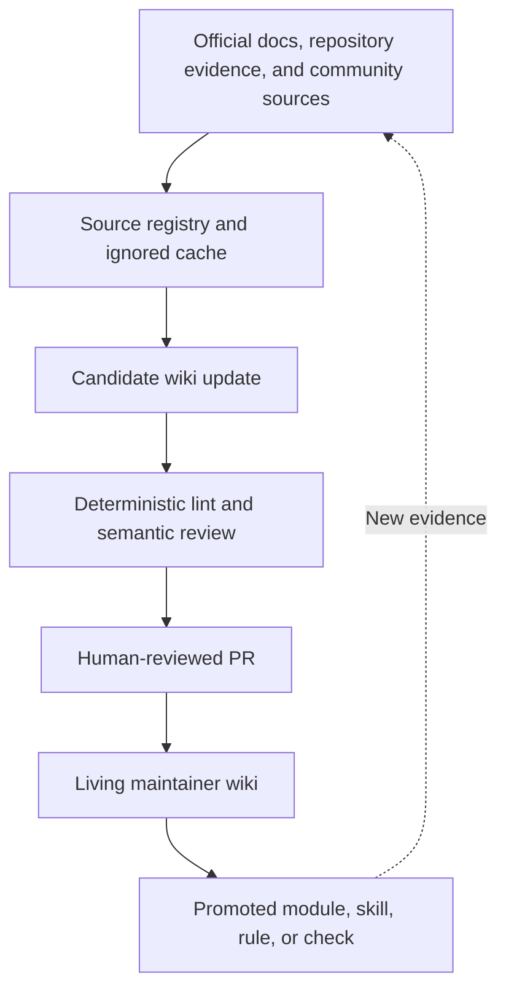

# 13 · Живая wiki Codex

## Результат

Создайте слой знаний с предварительным ревью, который накапливает опыт работы
с Codex, не превращая сгенерированные сводки в непроверенную истину.

## Подход

При обычном поиске по документам каждый вопрос снова начинается с исходных
файлов. LLM wiki сохраняет повторяющееся обобщение в связанных Markdown-страницах:



Схема связывает источники, реестр и игнорируемый кэш, проект изменения wiki,
детерминированную и смысловую проверку, PR с ревью человеком, живую wiki
и перенос знаний в модуль, навык, правило или проверку. Новые подтверждения
возвращают процесс к источникам.

Репозиторий адаптирует [подход LLM Wiki Карпати](https://gist.github.com/karpathy/442a6bf555914893e9891c11519de94f)
к инженерным инструкциям:

1. **Источники** сохраняют происхождение сведений.
2. **Страницы wiki** обобщают текущее понимание, противоречия и неопределённость.
3. **Навык сопровождения** определяет запросы, включение источников, проверки и перенос знаний.

## Разделяйте назначения

| Механизм | Что хранить |
|---|---|
| Запрос | Цель, контекст, ограничения и критерии завершения одной задачи |
| `AGENTS.md` | Обязательные правила репозитория и команды проверки |
| Навык | Повторяемую процедуру с ясными требованиями к подтверждениям |
| Живая wiki | Обобщённые подтверждения, решения, эксперименты и неопределённость |
| MCP | Актуальные внешние данные или действия |
| Автоматизация | Устойчивый периодический процесс с ограниченными правами |

Память Codex может помогать личному запоминанию, но обязательные знания команды
должны храниться в версионируемых материалах репозитория.

## Архитектура с предварительным ревью

Директория [`knowledge/`](../../knowledge/README.md) в Git содержит:

- машиночитаемый реестр источников;
- небольшой индекс для направления поиска Codex;
- страницы тем, решений и экспериментов;
- журнал операций;
- ни одного скопированного внешнего корпуса документов.

Временные загрузки помещаются в игнорируемый Git каталог `.wiki-cache/`.
Это ограничивает размер репозитория, сохраняет авторские права и секреты,
но оставляет происхождение сведений проверяемым.

Реализация намеренно начинается без базы данных, векторного поиска,
MCP-сервера и веб-интерфейса. Добавляйте их только тогда, когда измерения
поиска покажут недостаточность Markdown-поиска с предварительным чтением индекса.

## Шесть операций

### Query — запрос

Прочитайте индекс, найдите подходящие страницы и синонимы, затем ответьте
со ссылками на wiki. По умолчанию запрос работает только на чтение,
пока пользователь не попросит сохранить или изменить знания.

### Capture — фиксация

Сохраните явный устойчивый инженерный урок из объединённого изменения,
инцидента, замечания ревью или измеренного запуска. Используйте материалы
репозитория как подтверждения, обновляйте минимальную подходящую страницу.
Если результат слишком узок или временен, допустим вывод «существенных изменений нет».

### Ingest — включение источника

Зарегистрируйте источник, определите его авторитетность, обновите все существенно
затронутые страницы, сохраните разногласия, обновите индекс и журнал, подготовьте PR.
Обрабатывайте источники последовательно: реестр, индекс и журнал общие.

### Archive — архивирование

Сохраняйте полезный ответ только по просьбе пользователя. Помечайте его
экспериментальным, сохраняйте ID источников и ссылайтесь на существующие страницы
вместо копирования. Архивированное обобщение не является проверенной инструкцией
и не переносится автоматически в другие материалы.

### Lint — проверка

Выполните:

```bash
python3 skills/maintain-codex-wiki/scripts/wiki_lint.py .
```

Проверяются записи источников, метаданные страниц, зарегистрированные ссылки,
покрытие индексом и локальные ссылки. Человек всё ещё должен оценить,
подтверждают ли источники утверждения и не устарели ли рекомендации.

### Promote — перенос

Переносите устойчивые знания в минимально подходящий механизм:

- обязательное правило → `AGENTS.md`;
- повторяемый измеренный процесс → навык;
- учебный материал → модуль или ресурс;
- механический инвариант → скрипт, CI или hook;
- нерешённые вопросы подтверждений → оставить в wiki.

Перенос должен быть явным и проверяемым. Задача по расписанию может сообщать
о расхождениях или готовить draft PR, но не должна автоматически объединять
фактические изменения.

## Практикум A: запрос без загрузки всех материалов

Установите навык сопровождения во временном клоне:

```bash
mkdir -p .agents/skills
cp -R skills/maintain-codex-wiki .agents/skills/
```

Начните новую задачу:

```text
$maintain-codex-wiki Query: что этот репозиторий сейчас знает об эффективности
оркестрации? Ссылайся на страницы wiki, отделяй подтверждения от рекомендаций
и не изменяй файлы.
```

Убедитесь, что Codex читает индекс и подходящую страницу, а не просматривает все модули.

## Практикум B: безопасное включение источника

Выберите актуальную официальную страницу Codex. Работайте в ветке и попросите:

```text
$maintain-codex-wiki Ingest: включи этот официальный источник в живую wiki.
Зарегистрируй метаданные, используй .wiki-cache для загруженного содержимого,
обнови только затронутые страницы, выполни wiki lint. Перенос в учебный курс
оставь отдельным решением.
```

Проверьте:

- правильно ли классифицирован источник;
- остались ли внешние тексты вне Git;
- ссылается ли каждое изменённое утверждение на зарегистрированный источник;
- видны ли прежние разногласия;
- меньше ли diff, чем при прямом переписывании нескольких модулей.

## Практикум C: измерить пользу

Используйте [базовый эксперимент эффективности wiki](../../knowledge/experiments/wiki-efficiency-baseline.md).
Сравните одинаковые вопросы сопровождения без wiki, с запросом через индекс
и с навыком сопровождения. Зафиксируйте модель, уровень рассуждений, ревизию,
инструменты и критерии завершения.

Не объявляйте wiki более эффективной, пока повторные результаты не сохранят
качество ответов и не улучшат нахождение подтверждений или контекста.

## Проверка

- Query по умолчанию не записывает файлы.
- Источники имеют устойчивые ID и допустимые локальные пути или HTTPS URL.
- Доступные ревизии источников и зависимости затронутых страниц записаны.
- Полные внешние тексты остаются вне Git, если распространение не разрешено.
- Все страницы wiki есть в индексе и проходят детерминированную проверку.
- Практики сообщества никогда не обозначаются официальным поведением.
- Фактические изменения требуют ревью.
- Перенос не дублирует полный текст модулей или навыков.
- Заявления об эффективности подкреплены записанным сравнением.

## Источники

### Официальные

- [Пользовательские инструкции через `AGENTS.md`](https://developers.openai.com/codex/guides/agents-md)
- [Создание и использование навыков](https://developers.openai.com/codex/skills)
- [Автоматизации](https://developers.openai.com/codex/app/automations)

### Источники вдохновения из сообщества

- [Идея LLM Wiki Карпати](https://gist.github.com/karpathy/442a6bf555914893e9891c11519de94f)
- [Astro-Han/karpathy-llm-wiki](https://github.com/Astro-Han/karpathy-llm-wiki)
- [lucasastorian/llmwiki](https://github.com/lucasastorian/llmwiki)
- [atomicstrata/llm-wiki-compiler](https://github.com/atomicstrata/llm-wiki-compiler)
- [AlmanacCode/codealmanac](https://github.com/AlmanacCode/codealmanac)
- [KevinLuo1/kw-okf-memory-skill](https://github.com/KevinLuo1/kw-okf-memory-skill)

Дата проверки в оригинале: 2026-07-31.
