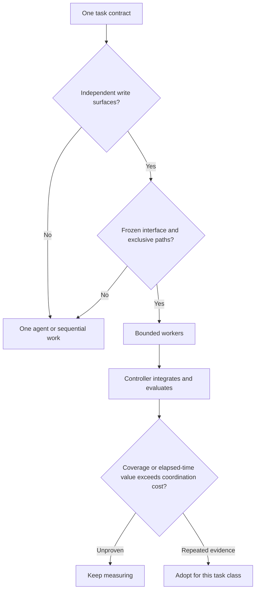

# Когда Codex нужны несколько агентов? Проверка на benchmark

Дополнительные агенты не гарантируют лучшую разработку. Они обычно добавляют
токены, дубли контекста, задержку передачи и риски интеграции.
Обоснованные преимущества конкретнее: сокращение времени независимой работы,
изоляция исследования и подтверждения специалиста, которые мог пропустить один агент.

Полезный вопрос:

> Есть ли в задаче независимая работа с чёткими границами,
> ценность которой превышает стоимость координации?

Codex How To содержит benchmark без зависимостей для проверки этого вопроса.

Раскрытие авторства: автор оригинала сопровождает
[Codex How To](https://github.com/Phelan164/codex-howto), независимый открытый
проект с benchmark, оценщиком и измерениями. Перевод не является новым запуском.

## Минимальное правило решения

Один агент подходит для маленькой правки, неустоявшегося интерфейса
или последовательных шагов над центральными файлами.
Ограниченную оркестрацию рассматривайте при всех условиях:

1. Не менее двух реальных областей ответственности.
2. У каждого пишущего агента исключительные пути.
3. Интерфейс между ними зафиксирован до реализации.
4. Управляющий агент сохраняет интеграцию, системные проверки и ревью.
5. Исполнители возвращают краткие подтверждения вместо пересказа диалога.
6. Единая внешняя приёмка оценивает все способы выполнения.



Схема: единые условия → независимые области записи → устойчивый интерфейс
и отдельные пути → ограниченные исполнители → интеграция и оценка.
Внедряйте для класса задач лишь при повторных подтверждениях пользы.

Название роли не задаёт границы. «Backend-агент», «тестовый агент» и «ревьюер»
могут пересекаться в файлах или выполнять зависимые этапы.
Конкретная граница: один пишет `incident/**`, другой `web/**`,
оба не меняют общий контракт.

## Задача benchmark

[Benchmark реагирования на инциденты](https://github.com/Phelan164/codex-howto/tree/v0.6.0/labs/incident-response-benchmark)
требует небольшое приложение из нескольких компонентов без сторонних зависимостей:

- потокобезопасное JSON-хранение с атомарной заменой;
- валидацию, оптимистическую конкурентность и переходы статуса;
- HTTP API и статическую выдачу с защитой обхода путей;
- адаптивный доступный браузерный клиент;
- целевые тесты, интеграцию, ревью и отчёт.

Две области реализации:

```text
incident/**  # persistence, validation, HTTP adapter
web/**       # HTML, CSS, browser behavior
```

Оба метода начинают с одного коммита, задания, тестов и контракта.
Оркестрация допускает не больше двух исполнителей.
Управляющий отвечает за оценку и финальный отчёт.

Единый внешний оценщик проверяет целостность примера, область кандидата,
конкурентное хранение, строго атомарную запись, валидацию и ошибки,
живой HTTP, обход путей, статические требования браузера и темы отчёта.

## Что показала первая проверка

Пробный запуск подтвердил работоспособность инфраструктуры:

| Показатель | Один агент | Управляющий и два исполнителя |
|---|---:|---:|
| Принят после ревью | Да | Да |
| Предоставленные тесты | 4/4 | 4/4 |
| Группы внешнего оценщика | 6/6 | 6/6 |
| Конфликты правок | 0 | 0 |
| Интеграционные переделки | 0 | 0 |
| Исправления внутреннего ревью | 1 | 0 |
| Браузерное взаимодействие кандидата | Нет | Да |
| Суммарные токены | Недоступны | Недоступны |
| Сопоставимое время | Нет | Нет |

Оркестрированный кандидат предоставил живые проверки создания, фильтрации,
переходов состояния, ошибок валидации, консоли и мобильного viewport.
Один агент нашёл и исправил сообщение о конфликте в финальном ревью;
внешний управляющий позже проверил живое HTTP-поведение.

Это выполнимость, не превосходство. Запуски пересекались, суммарные токены
управляющего и исполнителей недоступны, на метод был один кандидат.
Выводы о большей скорости, дешевизне или общей надёжности недопустимы.

До интерпретации прочитайте [полный отчёт](https://github.com/Phelan164/codex-howto/blob/v0.6.0/examples/measurements/incident-orchestration-smoke-2026-08-11.md).

## Контракт управляющего с ограничением числа агентов

Большая цель не разрешает создавать агента для каждого существительного.
Зафиксируйте контракт и максимальную полезную схему:

```text
Полностью реализуй задачу реагирования на инциденты.

До делегирования:
- зафиксируй HTTP-контракт и контракт данных;
- подтверди независимость incident/** и web/** для записи;
- оставь оценщик и отчёт управляющему агенту.

Бюджет делегирования:
- не больше двух исполнителей реализации;
- backend отвечает только за incident/**;
- frontend отвечает только за web/**;
- исполнители не меняют TASK.md, тесты, оценщик или чужие пути.

Каждый возвращает:
- изменённые файлы;
- целевые проверки и результаты;
- проверенное наблюдаемое поведение;
- сбои, повторы и всё непроверенное.

Управляющий выполняет предоставленные и внешние проверки, проверяет интеграцию,
проводит ревью всего diff, исправляет подтверждённые проблемы и пишет один отчёт.
```

Делегирование не обязательно. При нестабильном интерфейсе или связанных
областях правильно выбрать одного агента или последовательный конвейер.

## Качество прежде скорости

Сначала запишите факты:

| Направление | Подтверждения |
|---|---|
| Приёмка | Одинаковые оценщик и критерии качества |
| Покрытие | Проверенное поведение, найденные сбои, непроверенные части |
| Общая стоимость | Управляющий и все исполнители, включая неуспехи |
| Время | Последовательные изолированные запуски при сопоставимой нагрузке |
| Координация | Число исполнителей, задержки передачи, повтор исследования |
| Интеграция | Конфликты, несовпадения контрактов, переделки |
| Участие человека | Исправления, повторы, согласования, ручные действия |

Телеметрия управляющего не заменяет суммарные токены.
Не удаляйте неуспешных кандидатов и не сравнивайте пересекающиеся запуски
как изолированные. Недоступные метрики — `unavailable`.

Один [отчёт оркестрации](https://github.com/Phelan164/codex-howto/blob/v0.6.0/examples/templates/orchestration-run-receipt.md)
на кандидат. Выполните минимум три свежие последовательные пары,
чередуя порядок методов. Приёмку и полноту подтверждений сравнивайте до времени и токенов.

## Когда оркестрация обычно проигрывает

Один агент или последовательный процесс предпочтительны, если:

- один агент способен удержать нужный контекст;
- исполнители меняют одни файлы;
- подзадача зависит от нерешённого дизайна другой;
- задача — одна цепочка отладки;
- оценщик не может связать сбой с кандидатом;
- расход агентов невидим, а решение зависит от стоимости;
- единственное основание — доступность параллелизма.

Для маленьких правок инструкции процесса могут стоить больше контекста,
чем экономят. Прежние измерения показали минимальный успешный расход контроля
без навыка на backend-дефекте и компактного цикла на средней игре.
Класс задачи имеет значение.

## Когда оркестрация может оправдаться

Подходящие случаи:

- независимые модули с устойчивыми интерфейсами;
- ревью на чтение по безопасности, надёжности и тестам;
- шумное исследование с краткой сводкой до реализации;
- frontend и backend после фиксации API;
- задачи, где специалист добавляет независимо проверяемые runtime-подтверждения.

Польза может заключаться в покрытии. Настоящий дефект или недостающие
браузерные, deployment- или security-подтверждения могут оправдывать
больше токенов. Это решение о качестве, не заявление об экономии.

## Воспроизведите или опровергните

Полезна контролируемая пара, способная изменить рекомендацию:

1. Создайте одинаковые временные исходные копии.
2. Фиксируйте модель, рассуждения, разрешения, инструменты, задание, время и оценщик.
3. Последовательно выполните один запуск агента и одну ограниченную оркестрацию.
4. Чередуйте порядок минимум в трёх парах.
5. Сохраните неуспехи и полную телеметрию управляющего с исполнителями.
6. Опубликуйте отчёты без конфиденциальных данных и ограничения.

Отправьте результат в [issue воспроизведения](https://github.com/Phelan164/codex-howto/issues/23)
или предложите проверенную benchmark-редакцию отдельным PR.
Отрицательные и нейтральные результаты полезны.

Codex How To — независимый проект сообщества.
Официальная документация OpenAI остаётся авторитетной для текущего поведения продукта.
